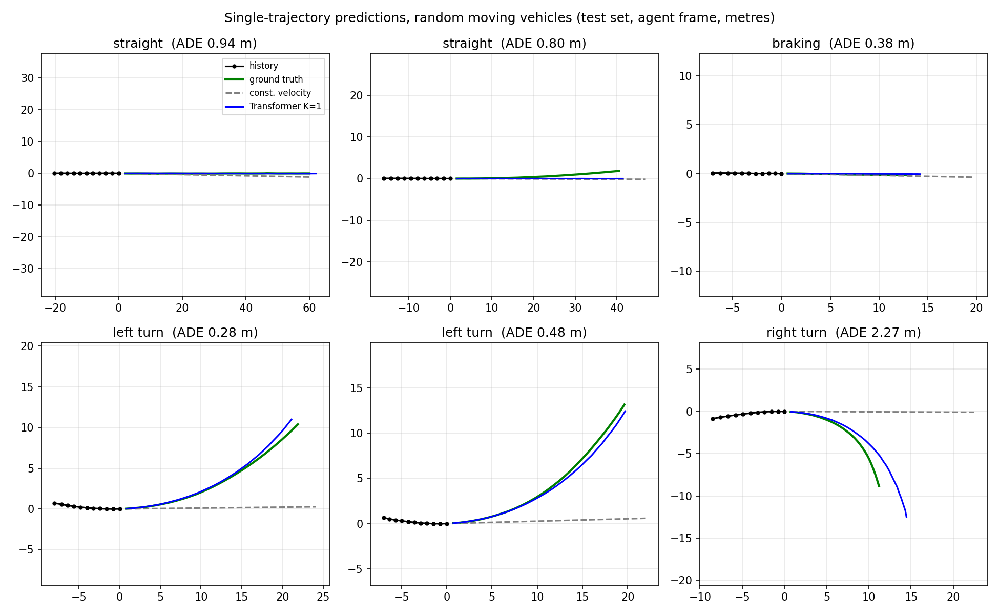
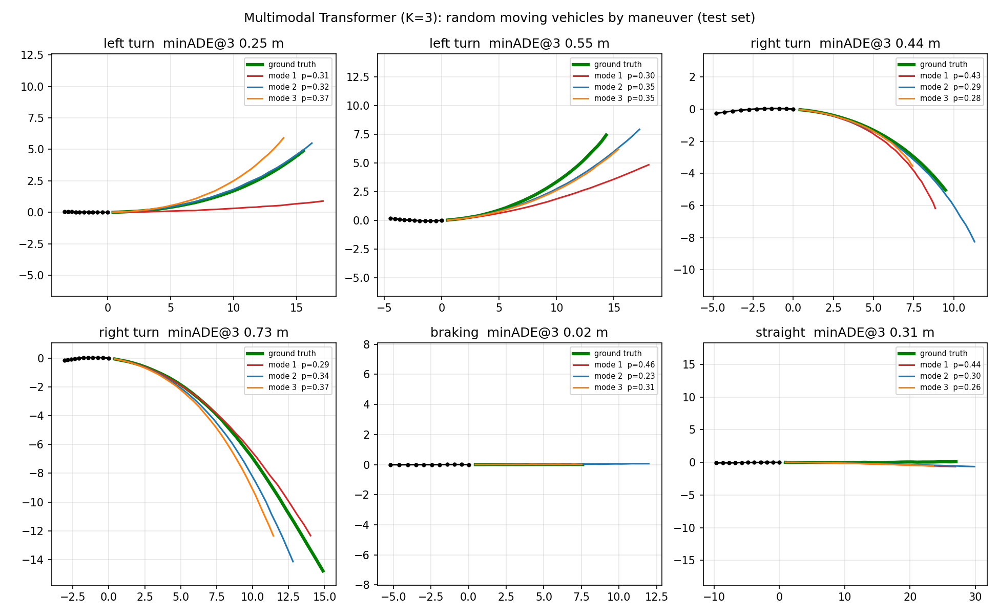
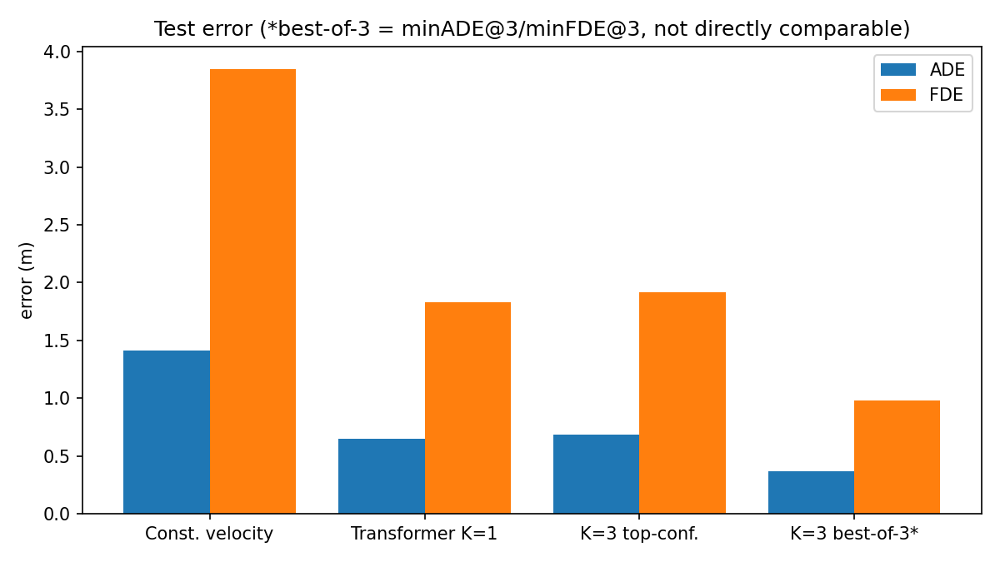
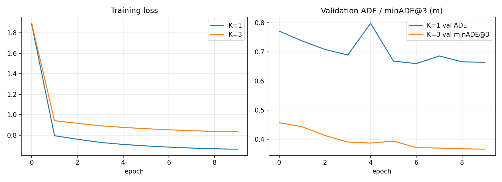

# Multimodal Transformer Vehicle Trajectory Prediction (Waymo)

CSCE 883 project, Transformer part (Abdulahi Taiwo). Teammate: Pallavi Aashadapu (LSTM).

Predicts where a vehicle will be over the next **3 seconds (30 positions)** from its last
**1.1 seconds (11 positions)**, using the Waymo Open Motion Dataset v1.3.1. Compares a
constant-velocity baseline, a single-output Transformer (K=1) and a multimodal
Transformer that outputs 3 candidate paths with probabilities (K=3).

## Project structure

```
waymo-trajectory-transformer/
├── preprocess_womd.py     # Waymo scenario file -> small .npz of vehicle samples (no TensorFlow needed)
├── fetch_convert.py       # download Waymo files in batches + convert in parallel (any number, up to all 1000)
├── models.py              # Transformer (K=1 / K=3), losses, constant-velocity baseline
├── train.py               # training + per-epoch validation, saves best checkpoint
├── analyze.py             # tables, maneuver breakdown, bootstrap CIs, 4 figures
├── requirements.txt
├── scripts/
│   ├── setup.sh           # one-time setup on a Linux GPU machine (e.g. Chameleon)
│   └── run_full.sh        # whole pipeline in one command
├── notebooks/
│   └── colab_runner.ipynb # same pipeline for Google Colab
├── tests/
│   └── test_pipeline.py   # self-test, no download or GPU needed
└── results/
    └── 1000_files/        # final results: tables, maneuver breakdown, bootstrap CIs, figures, training logs
```

## Setup

You need a Google account registered at https://waymo.com/open (license accepted).

**Linux / Chameleon**
```bash
bash scripts/setup.sh                       # Python env, PyTorch, Google Cloud CLI
source ~/.bashrc
gcloud auth login --no-launch-browser       # sign in with the Waymo-registered account
python tests/test_pipeline.py               # should print "All tests passed."
```

**Local (VS Code, any OS) for reading/editing code and running the tests**
```bash
python -m venv .venv
# Windows: .venv\Scripts\activate     macOS/Linux: source .venv/bin/activate
pip install -r requirements.txt
python tests/test_pipeline.py
```

**Google Colab**: open `notebooks/colab_runner.ipynb`.

## Run

```bash
tmux new -s waymo                   # keeps running if SSH drops (detach: Ctrl+B then D)
bash scripts/run_full.sh 5 2        # quick test: 5 training files, 2 epochs
bash scripts/run_full.sh 1000 10    # full dataset: 1000 training files, 10 epochs
```

`run_full.sh N EPOCHS` creates `data_N/{train,val,test}` and `runs_N/`. Validation = Waymo
validation files 00000–00004, test = 00005–00009 (Waymo's own testing split hides the
future, so it cannot be scored). Re-running skips files already converted.

Individual steps:
```bash
python fetch_convert.py --split training --start 0 --end 100 --out data_100/train --workers 16
python train.py   --data data_100 --eval_cv                       # constant-velocity baseline
python train.py   --data data_100 --K 1 --epochs 30 --out runs_100
python train.py   --data data_100 --K 3 --epochs 30 --out runs_100
python analyze.py --data data_100 --runs runs_100 --split test
```

## Data preparation (what preprocess_womd.py does)

- Vehicles only, valid at all 41 steps (11 history + 30 future).
- Agent-centred frame: current position = (0, 0), rotated so the car faces +x.
- Input per step: x, y, vx, vy, sin and cos of heading change (11 × 6).
- Target: future x, y (30 × 2), in metres.
- Cars moving < 2 m in 3 s: only 10% kept (same rule in every split).

## Model

Linear embedding (6 → 128) + learned summary token + learned positional embedding →
3 Transformer encoder layers (4 heads, feed-forward 512, dropout 0.1, pre-norm) →
MLP head (128 → 256 → K × 30 × 2) + confidence head (K scores).
K=1: 646,205 parameters. K=3: 677,303 parameters.

Training: AdamW (lr 3e-4, weight decay 1e-4), one-cycle schedule, batch 256,
gradient clipping 1.0, seed 0. Loss: K=1 = ADE; K=3 = best-of-3 ADE + 0.5 × cross-entropy
on which path was best. Best epoch chosen on validation; final scores on test.

## Results (all 1000 training files, test set of 12,700 vehicles)

Trained on all 1,000 Waymo training files (about 4.09 million vehicle samples) for 10 epochs
on an NVIDIA RTX 6000 GPU (Chameleon Cloud). Best epoch chosen on validation (12,145 vehicles);
all numbers below are on the separate test set.

| Model | ADE (m) | FDE (m) | minADE@3 (m) | minFDE@3 (m) |
|---|---|---|---|---|
| Constant velocity | 1.414 | 3.849 | — | — |
| Transformer K=1 | 0.650 | 1.830 | — | — |
| Transformer K=3, top-confidence path | 0.683 | 1.917 | — | — |
| Transformer K=3, best of 3 paths | — | — | 0.364 | 0.977 |

**Paired bootstrap (2,000 resamples), 95% confidence intervals**

| Comparison | Mean difference (m) | 95% CI |
|---|---|---|
| ADE: constant velocity − K=1 | 0.763 | [0.743, 0.785] |
| FDE: constant velocity − K=1 | 2.019 | [1.963, 2.073] |
| ADE: K=1 − K=3 top path | −0.033 | [−0.038, −0.028] |
| FDE: K=1 − K=3 top path | −0.087 | [−0.101, −0.073] |

The Transformer cuts constant-velocity error by about 54% (ADE) and 52% (FDE). The K=3 model's
single most-confident path is slightly worse than K=1, but the best of its 3 paths is much better
(minADE 0.364 m), showing it captures several plausible futures.

**By maneuver (test set)**

| Maneuver | n | CV ADE | K=1 ADE | K=3 minADE | CV FDE | K=1 FDE | K=3 minFDE |
|---|---|---|---|---|---|---|---|
| Straight | 7,484 | 1.390 | 0.740 | 0.406 | 3.752 | 2.079 | 1.078 |
| Braking | 1,548 | 2.517 | 0.847 | 0.433 | 6.855 | 2.235 | 1.084 |
| Left turn | 583 | 3.313 | 0.954 | 0.698 | 9.241 | 2.808 | 2.057 |
| Right turn | 479 | 2.985 | 1.158 | 0.784 | 8.358 | 3.418 | 2.370 |
| Slow / stationary | 2,606 | 0.113 | 0.115 | 0.048 | 0.306 | 0.362 | 0.125 |

The biggest gains over constant velocity are on turns and braking, where a straight-line guess fails.

**Figures** (in `results/1000_files/`)

| | |
|---|---|
|  |  |
|  |  |

## Notes

- The LSTM (Pallavi) should be evaluated on the same `data_N/test` files, with predictions
  saved as an array of shape (number of test samples, 30, 2) in alphabetical file order.
- Data use follows the Waymo Dataset License Agreement for Non-Commercial Use.
